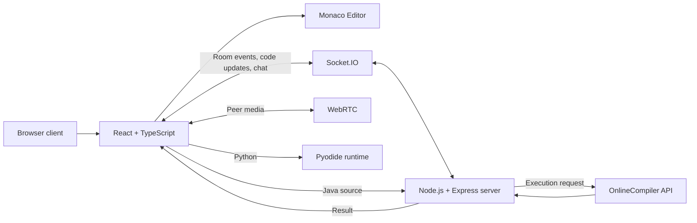

<!-- CodeTogether | VS Code-inspired dark green README -->
<div align="center">
  
  <p><strong>A browser-based collaborative coding workspace for learning, teaching, and pair programming.</strong></p>
  <p>
    <a href="https://codetogether-2-v22l.onrender.com"></a>
    <a href="https://github.com/deekshitaa1/CodeTogether"></a>
    <a href="https://codetogether-8cuz.onrender.com/health"></a>
    
  </p>
  <sub>React 19 · TypeScript · Node.js · Express · Socket.IO · Monaco · WebRTC · Pyodide</sub>
</div>

---

## 01 / The idea

Remote coding sessions often mean switching between an editor, chat app, meeting link, and compiler. **CodeTogether brings those core activities into one browser-based workspace.**

Create a room, invite collaborators, edit code together, discuss a solution, and run supported programs — without requiring every participant to install a desktop IDE.

## 02 / Live application

- **Frontend:** https://codetogether-2-v22l.onrender.com
- **Backend health:** https://codetogether-8cuz.onrender.com/health
- **Source:** https://github.com/deekshitaa1/CodeTogether

## 03 / Features

| Capability | What it does |
|---|---|
| Collaborative rooms | Create or join a room by name and see connected participants. |
| Live code editing | Monaco Editor with room updates delivered through Socket.IO. |
| Host permissions | Allow everyone to edit, keep editing host-controlled, or assign access to one participant. |
| Room chat | Exchange messages with people in the same coding session. |
| Audio / video | Start an in-room call and manage camera and microphone controls. |
| Classroom mode | Teachers create invitation codes, publish code, and students work independently. |
| Learning status & notes | Students can update their status and keep personal classroom notes. |
| Code execution | Run Python in-browser with Pyodide and Java through the backend execution endpoint. |
| Workspace UI | Dark and light themes, responsive layout, file selection, code search, and a floating call panel. |

## 04 / The workspace

### Collaborative coding room
- Monaco Editor provides the in-browser coding experience.
- Code changes are sent through Socket.IO and broadcast to other participants in the room.
- The host controls editing permissions.
- Chat and a floating video-call panel keep collaboration close to the code.

### Classroom
- A teacher creates a classroom and shares its invitation code.
- The teacher has a separate private code area and can publish code to students.
- Students edit their own code, update a learning status, and write personal notes.
- Teachers can monitor student work from the classroom view.

### Code execution

| Language | Runtime | Execution path |
|---|---|---|
| Python | Pyodide 0.27.7 | Runs in the browser through WebAssembly. |
| Java | OnlineCompiler API | Sent to the backend execution endpoint; output is returned to the workspace. |

The output panel displays execution results and errors. It is an output/status panel, **not** a full operating-system terminal.

## 05 / System architecture



1. **Join:** the browser connects to the backend using Socket.IO.
2. **Room state:** the server tracks participants and sends the current room state.
3. **Edit and authorize:** the client sends code updates; the backend checks editing permissions.
4. **Synchronize:** permitted updates are broadcast to the other participants.
5. **Communicate:** chat and WebRTC signaling use Socket.IO events.
6. **Call:** browsers establish peer-to-peer media connections using WebRTC.
7. **Execute:** Python runs in-browser; Java is sent to the backend and configured execution service.

## 06 / Technology stack

| Layer | Technologies |
|---|---|
| Frontend | React 19, TypeScript, Vite |
| Code editor | Monaco Editor, @monaco-editor/react |
| Backend | Node.js, Express 5, TypeScript, tsx |
| Real-time | Socket.IO client and server |
| Audio / video | WebRTC, browser MediaDevices APIs |
| Python runtime | Pyodide 0.27.7 |
| Java runtime | Backend API, OnlineCompiler API |
| UI | CSS, Lucide React |
| Deployment | Render |

**Synchronization detail:** current room code synchronization is implemented through Socket.IO events. Although Yjs and y-websocket are present in the dependency list, the current implementation should not be described as Yjs-based synchronization.

## 07 / Repository structure

```text
CodeTogether/
├── src/
│   ├── App.tsx              # Main room, classroom, and call workflows
│   ├── App.css              # Application styles and responsive layout
│   ├── CodeScene.tsx        # Additional visual scene component
│   ├── main.tsx             # Frontend entry point
│   └── index.css            # Global styles
├── server/
│   ├── server.ts            # Express API, Socket.IO, room and classroom events
│   └── package.json         # Backend dependencies and scripts
├── index.html
├── package.json
└── README.md
```

## 08 / Run locally

**Prerequisites:** Node.js, npm, and an OnlineCompiler API key/configuration for Java execution.

**1. Install frontend dependencies**
```bash
npm install
```

**2. Install backend dependencies** — open a second terminal:
```bash
cd server
npm install
```

**3. Configure the backend**

Configure the backend port as 3001, the allowed frontend origin, and the OnlineCompiler API key in the backend environment. Keep secrets in environment variables; never commit API keys. For local development, point the frontend API address to http://localhost:3001.

**4. Start the backend** — from the server directory:
```bash
npm run dev
```

**5. Start the frontend** — in another terminal at the project root:
```bash
npm run dev
```

Open the local URL printed by Vite. Keep both processes running.

**6. Build the frontend**
```bash
npm run build
```

## 09 / Current boundaries

This section documents the current implementation rather than implying features that are not yet present.

- **In-memory state:** room, participant, and classroom state is held in backend memory, not a database. A backend or service restart can clear active state and classroom data.
- **No persistent project storage:** rooms start with a small set of starter files; full cloud file management and persistent project storage are not implemented.
- **Execution scope:** Python and Java are supported in the main shared workspace.
- **Output visibility:** execution output is local to the participant who runs the code; it is not automatically broadcast to everyone in the room.
- **External Java dependency:** Java execution depends on the configured OnlineCompiler service and its availability/limits.
- **Browser Python dependency:** Pyodide must load successfully from its CDN.
- **Authentication:** room names are used to join rooms; a full user-account and authentication system is not currently provided. Do not use rooms for confidential code or sensitive information.
- **WebRTC requirements:** camera and microphone permissions are required; restrictive networks or browser settings may affect calls.
- **Hosting:** free Render services may sleep after inactivity, so the first request can take longer while a service wakes up.

## 10 / Where it fits

- **Classrooms and labs** — demonstrate code and let students practise independently.
- **Pair programming** — solve problems in a shared session.
- **Remote mentoring** — explain code with chat and video.
- **Group assignments** — collaborate without switching between separate tools.
- **Interview practice** — discuss and observe a coding exercise live.
- **Hackathons** — bring a small team into the same coding workspace.

CodeTogether is a collaboration and learning workspace. It is **not yet** a full replacement for a production IDE, Git hosting platform, or enterprise interview system.

---

<div align="center">
  <sub>Designed around a simple idea: make it easier to think, build, and learn together.</sub>
  <br />
  <a href="https://codetogether-2-v22l.onrender.com"><strong>Open CodeTogether ↗</strong></a>
</div>
